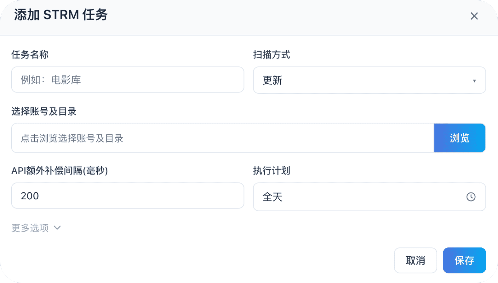
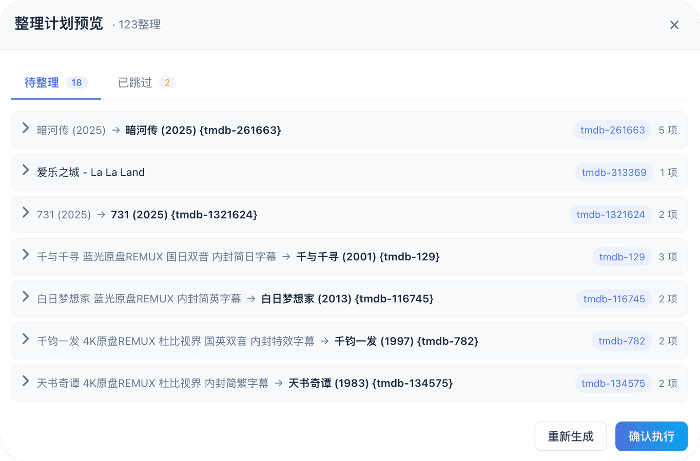

<a name="readme-top"></a>
<br>
### 本项目上游是： 开源 LitePan项目，链接地址：https://github.com/Ponphil/LitePan

---

## ▎ 一条龙：从资源到播放

**MyPan 不是网盘管理器，是一条完整的影片流水线。** 资源从哪儿来、怎么落到网盘、
怎么变得整整齐齐、怎么被播放器认出来 —— 全流程打通，中间不需要你手动搬一次文件。

```
 ① 发现资源          ② 落到网盘            ③ 目录整理              ④ STRM           ⑤ 刮削           ⑥ 播放
┌───────────┐    ┌──────────────┐    ┌──────────────────┐    ┌────────────┐   ┌───────────┐   ┌──────────┐
│ 磁力 / ed2k│    │ 网盘原生离线  │    │ 删广告小文件      │    │ 生成 .strm │   │ 写 nfo    │   │ Emby     │
│ 分享链     │ →  │ 或内置下载器  │ →  │ 批量改名          │ →  │ 指向本机   │ → │ 存海报    │ → │ Jellyfin │
│ 直链 / 种子 │    │ 转存别人的分享│    │ 移进作品文件夹    │    │ 播放网关   │   │ 海报墙    │   │ 飞牛 …   │
└───────────┘    └──────────────┘    └──────────────────┘    └────────────┘   └───────────┘   └──────────┘
   TG 订阅 /          离线下载 /          目录整理 /             STRM 任务         刮削            302 直链
   番号订阅            分享转存            番号自动归档                          自动联动        或本机代理
```

更具体地说，每一步都在做这些事：

| 环节 | 干什么 | 关键能力 |
|---|---|---|
| **① 发现** | 从 TG 频道、网盘搜索、番号站点把资源找出来 | TG 影片订阅 · 番号（JAV）订阅 · **搜索转存** · 盘搜 |
| **② 落盘** | 把链接交给网盘自己去下，或让 MyPan 自己下 | 网盘原生离线 · 内置 BT 下载器 · **分享链转存** |
| **③ 整理** | 把乱七八糟的目录变成规规矩矩的作品文件夹 | **删广告小文件** · **批量改名** · **移进目标文件夹** · 先预览后应用 |
| **④ STRM** | 给每个视频生成一个 `.strm` 文本文件，播放器当它是本地片 | STRM 任务 · 播放网关 · 302 直链 / 本机代理 |
| **④′ 番号元数据** | 番号影片按侧车 JSON 在 `.strm` 同层写 nfo 与封面 / 剧照 | 媒体类型＝番号影片 · 封面裁海报 · extrafanart |
| **⑤ 刮削** | 写 nfo、下海报，让海报墙认得这部片 | TMDB 匹配 · 元数据写入 · 可追更 |
| **⑥ 播放** | 播放器直连网盘播放，不占服务器带宽 | Emby / Jellyfin / 飞牛代理 · WebDAV · FUSE |

**其中「整理」那一步是真正省事的地方**：不用你一个个文件夹去翻。
程序会把广告 `.url` / `.txt` / `.jpg` 这类小垃圾挑出来、把文件名规整成番号、
把散在根目录的片子移进它该在的作品目录里 —— 而且**先给你看一遍计划，你点确认才动**。

> 整条流水线可以用「自动联动」串起来：离线下载一完成，自动触发整理 → STRM → 刮削 → 刷库。
> 你只管订阅，剩下的它自己跑。

## ▎ 功能简述

<table>
  <tr>
    <td width="50%" valign="top" align="center">
      <h3>多网盘聚合</h3>
      <p align="left">11 种网盘 / 存储，多账号统一管理，一个界面看完。</p>
      
    </td>
    <td width="50%" valign="top" align="center">
      <h3>跨盘秒传</h3>
      <p align="left">能秒传就秒传，否则自动上传。</p>
      
    </td>
  </tr>
  <tr>
    <td width="50%" valign="top" align="center">
      <h3>STRM 直连播放</h3>
      <p align="left">生成 <code>.strm</code>，对接 Emby / Jellyfin。</p>
      
    </td>
    <td width="50%" valign="top" align="center">
      <h3>STRM 刮削</h3>
      <p align="left">写 nfo / 海报，海报墙可追更。</p>
      
    </td>
  </tr>
  <tr>
    <td width="50%" valign="top" align="center">
      <h3>目录整理</h3>
      <p align="left">删广告小文件、批量改名、归档到位，预览后再应用。</p>
      
    </td>
    <td width="50%" valign="top" align="center">
      <h3>自动联动</h3>
      <p align="left">整理、STRM、刮削、刷库串起来。</p>
      
    </td>
  </tr>
</table>

## ▎ 订阅：让资源自己找上门

- **TG 影片订阅** —— 订阅电影 / 剧集，程序去 Telegram 频道里搜资源并自动推送
  （磁力 / ed2k / 直链都能认，115 / 123 / 夸克 / 光鸭 / 百度 / 天翼 / 移动分享链还能自动转存）
- **番号（JAV）订阅** —— 按影片、演员、清单订阅，自动抓 JAVDB / JAVBUS 的磁链并推送；
  评论区里用户分享的链接也能一并纳入候选
- **推送通道自动判定** —— 按链接协议与目标网盘的实际能力挑「网盘原生离线」还是「内置下载器」，
  推不动的会告诉你为什么；**夸克 / 天翼 / 移动没有原生离线，它们的磁力 / 直链会自动落到内置下载器**
  （本机下完再上传）

## ▎ 挂载与更多功能

支持 WebDAV 与 FUSE 本地挂载，另有 302 直链、缓存保持、命名对齐、离线下载、
通知中心、封面抽帧等能力。

📖 **[各网盘能力对照表 → CAPABILITIES.md](./CAPABILITIES.md)** — 哪个网盘支持磁力 / ed2k / 秒传 / 分享转存 / 302，一张表看全。

📖 **[完整使用说明 → docs/GUIDE.md](./docs/GUIDE.md)** — 每个功能的详细用法、部署步骤、已知限制与常见问题。

---

## ▎ 快速开始

**Docker Compose 部署** · 镜像标签：`latest` 或指定 `v3.0.8`

### 一、先确认共享挂载已开启（用到 FUSE 挂载才需要）

mypan 用 fuse3 挂载云存储。**容器里的挂载要能在宿主机上看见**，宿主机那个目录的
挂载传播属性必须是 `shared` —— 不是的话，容器里的挂载会直接失败并报「权限被拒绝」。

先把下面路径换成你准备给容器用的那个目录，查一下：

```bash
findmnt -o TARGET,PROPAGATION /path/to/dir
```

`PROPAGATION` 那列写着 `shared` 就说明已经开着，**整节跳过**。
精简系统里没有 `findmnt`，也可以直接看 `/proc`——输出里带 `shared:` 就是开着的：

```bash
grep ' / ' /proc/self/mountinfo
```

**这些系统默认就开着，查一下确认即可，别白改**：LibreELEC、CoreELEC、飞牛 fnOS。

#### 没开的话，按 Docker 的运行方式选一个

**选项 1 · Docker 以 systemd service 运行**

```bash
sudo mkdir -p /etc/systemd/system/docker.service.d/
sudo cat <<EOF > /etc/systemd/system/docker.service.d/clear_mount_propagation_flags.conf
[Service]
MountFlags=shared
EOF
sudo systemctl restart docker.service
```

**选项 2 · Docker 不是以 systemd service 运行**

在宿主机上直接给那个挂载点开共享（路径与上面查的是同一个）：

```bash
sudo mount --make-shared $(df -P /path/to/dir | tail -1 | awk '{ print $6 }')
```

**举个例子**：假如你把 mypan 装在 `/volume1/docker/mypan`，那 `df` 会告诉你它落在
`/volume1` 这个挂载点上，所以命令就是：

```bash
sudo mount --make-shared /volume1
```

> ⚠️ **选项 2 重启后会失效** —— `mount --make-shared` 只在当前运行的系统里生效。
> 想让 mypan 重启后自动可用，得把这条命令加进系统启动项。

### 二、启动容器

```yaml
services:
  mypan:
    image: desstg/mypan:latest
    container_name: mypan
    restart: unless-stopped
    ports:
      - "5211:5211"
      # Emby / 飞牛影视反代的监听端口。反代监听在容器内部，
      # 不在这里发布出去，播放器就连不上（表现只是「连不上服务器」）。
      # 端口号要与后台「代理工具 → 反代端口」一致；用不到反代可以删掉这行。
      - "18097:18097"
      # 内置 Magnet 的 TCP/uTP/DHT 监听端口，默认不开启；要用内置磁力下载时
      # 取消下面两行的注释（TCP 和 UDP 必须都给，只给 TCP 会导致 DHT 找不到节点）
      # - "42069:42069/tcp"
      # - "42069:42069/udp"
    environment:
      - TZ=Asia/Shanghai
      # 内置盘搜的地址。指到下面那个 pansou service 的**容器名与内部端口**
      # （不是宿主机端口）。不装内置盘搜就把这行删掉/注释掉，
      # 让「搜索服务地址」回落到用户自己填的值。
      - LITEPAN_PANSOU_BASE_URL=http://pansou:8888
    volumes:
      - ./data:/app/data
      - ./strm:/app/strm
      - ./mounts:/app/mounts:shared
      # 宿主机上的媒体库目录（海报墙「数据源 → 本地目录」要用它）。
      # 左边换成你自己在宿主机上的媒体库路径，右边固定 /app/media；
      # 程序里注册「本地目录」时填的是**容器内路径**（/app/media），不是左边那个。
      # 要挂多个就照下面那行加，注意每个的容器内路径别重名。
      - /path/to/media:/app/media
      # - /path/to/media2:/app/media2 # 其他媒体库

      # 可选：将 FUSE 读缓存单独映射，建议放到更快的磁盘
      # - ./fuse_read_cache:/app/data/fuse_read_cache
    devices:
      - /dev/fuse:/dev/fuse
    pid: "host"
    privileged: true
    # 没有代理环境的，可以在下方配置tmdb的hosts
    # extra_hosts:
      # - "api.themoviedb.org:这里填写对应的ip"
      # - "image.tmdb.org:这里填写对应的ip"
    # 注意：也可以在程序内「目录整理 → TMDB 设置」填写反代主域名（自动补 /3 与 /t/p），与 hosts 二选一即可

  # ——————————————————— 可选：内置盘搜 ———————————————————
  #
  # 上游项目：https://github.com/fish2018/pansou（镜像直接用官方的，不自建）。
  # 不装的话把这一整段删掉 —— 但 mypan 那边也要把 LITEPAN_PANSOU_BASE_URL 去掉，
  # 否则会一直去连一个不存在的容器名。
  #
  # ⚠️ 盘搜要靠 TG 频道才有一半结果，而 t.me 在部分网络下连不上：
  # 那种情况给下面加 `HTTPS_PROXY`（地址写**宿主机的局域网 IP**，
  # 不能写 127.0.0.1 —— 那指的是容器自己）。
  pansou:
    image: ghcr.io/fish2018/pansou:latest
    container_name: pansou
    restart: unless-stopped
    # 只在内部网络暴露，不发布到宿主机。要在浏览器里单独用它的话，
    # 取消下面两行的注释（注意别和 mypan 的端口撞）。
    # ports:
    #   - "8888:8888"
    environment:
      - TZ=Asia/Shanghai
      - PORT=8888
      - CACHE_ENABLED=true
      - CACHE_PATH=/app/cache
      # 必须显式指定启用的插件；改完重启容器即可生效。
      - ENABLED_PLUGINS=dyyjpro,duoduo,djgou,feikuai,gaoqing888,gying,hdmoli,haitunsou,hunhepan,ikantv,jutoushe,kkv,dy4k,libvio,lingjisp,lou1,melost,meitizy,miosou,nyaa,ouge,panlian,pansearch,qqpd,quark4k,quarksoo,quarktv,qupanshe,sousou,thepiratebay,ting77,wanou,weibo,xb6v,xiaokupan,xiaozhang,xiaoyu,yingso,yulinshufa,yunso,yunsou,zlxapp,zxzj,rrbt,quarkres,diduan,erxiao,huban,labi,muou,shandian,zhizhen,clxiong,cyg,jsnoteclub,duanjuw,dyyj,nsgame,cldi,clmao,susu,u3c3,5266ys,dygang,leso,btbtlb,aipan,sopanya,hjzhencai,pan365,buerchen
      # 认证默认关闭。开了的话，把用户名密码写进 AUTH_USERS，
      # 并在 MyPan 的「搜索服务地址」旁边那个 Token 里填上登录拿到的令牌。
      - AUTH_ENABLED=false
    volumes:
      - ./data/pansou-cache:/app/cache
    healthcheck:
      # ⚠️ 配了 http_proxy（给 TG 频道用）时**不能**写成裸的 wget。
      # alpine 自带的 busybox wget **只读 http_proxy、完全不认 no_proxy**，
      # 于是这句自检会被送进代理，代理去连它自己的 localhost:8888 → 502，
      # 容器被标成 unhealthy。日志里就是
      # `wget: server returned error: HTTP/1.1 502 Bad Gateway`。
      test: ["CMD-SHELL", "http_proxy= https_proxy= HTTP_PROXY= HTTPS_PROXY= wget -q --spider http://127.0.0.1:8888/api/health"]
      interval: 30s
      timeout: 5s
      retries: 3
      start_period: 10s
```

### 三、打开界面

访问 `http://你的IP:5211`，默认管理员密码均为admin。

需要 FUSE 时请确保宿主机具备 `/dev/fuse` 权限。

> **媒体库目录**：compose 里那行 `/path/to/media:/app/media` 是给海报墙的「数据源 → 本地目录」用的 ——
> 左边换成你宿主机上的媒体库路径，然后在界面里登记**容器内路径** `/app/media`。不用就删掉这行。

#### 不想用 Docker？Windows 免安装版

每个 Release 的 Assets 里都有一个 `mypan-<版本>-windows-amd64.exe`（Windows 10/11 x64）：

```bat
mypan-v3.0.8-windows-amd64.exe --listen 0.0.0.0:5211 --data-dir "D:\mypan\data"
```

数据（数据库、日志、STRM 输出）默认落在 exe 同级的 `data` 与 `strm` 目录，建议用
`--data-dir` 指到别处，升级时只替换 exe。**云盘 FUSE 挂载是 Linux 专属**，Windows 版
没有那一块 —— 只用本机的硬盘 / 网络盘做海报墙、目录整理、离线下载没问题，挂 115 / 夸克
这类网盘请用 Docker 版。

### 四、盘搜（搜索转存 / 影视订阅的「搜网盘」都靠它）

盘搜是「拿片名去全网搜资源」的那条腿，后台**「搜索转存」页**与「影视订阅」的
**搜网盘 / 自动搜索**都走它。它是个独立的第三方服务，**MyPan 自己不含搜索能力**。

**默认已内置**：`docker-compose.yml` 里的 `pansou` service 就是它，
起来之后 MyPan 会自动指过去（`LITEPAN_PANSOU_BASE_URL=http://pansou:8888`），
**不用任何配置**。

```bash
docker compose up -d          # mypan + pansou 一起起
```

**不想装内置盘搜**：把 compose 里 `pansou` 那段和 `mypan` 的
`LITEPAN_PANSOU_BASE_URL` 一起删掉。那样「搜索转存」页会明确提示
「还没有可用的盘搜」，搜索与「搜网盘」都用不了 —— 除非你到
「影视订阅 → 推送设置 → 网盘搜索 → 搜索服务地址」填一个自己的盘搜地址（见下）。

> ⚠️ **不存在「默认公网站」这种东西了。** 老版本的默认地址是一个公开演示站
> （`so.252035.xyz`），该站**已实测连不上**（pansou 作者自认「被薅到摆烂、
> 返回 mock 数据」），所以已经删掉。现在「哪都没配」就是明确报错并告诉你
> 去哪装 —— 而不是拿着一个连不上的地址去打、让你以为是网络问题。

**想换成自己的盘搜**：填上就用你的，**同一项对「搜索转存」页与订阅的搜网盘都生效**。

| 你的盘搜 | 搜索服务地址填 |
|---|---|
| compose 内置的 | 不用填（自动） |
| `-p 805:80`（前后端一体版） | `http://192.168.31.4:805` |
| `-p 8888:8888`（纯 API 版） | `http://192.168.31.4:8888` |

把 `192.168.31.4` 换成**跑 pansou 那台机器的局域网 IP**。三点注意：

1. **只填到端口，不要带 `/api/search`** —— 路径程序自己拼。
2. **不要写 `127.0.0.1`**：MyPan 在容器里，那指的是它自己。用宿主机的局域网 IP。
3. 地址是内网的话，同一页的「**走全局代理**」要**关掉**（默认就是关的）。

盘搜自己还要能连上 t.me 才拿得到 TG 频道那一半结果 —— 需要的话在**它的容器**里配
`HTTPS_PROXY`（同样写宿主机的局域网 IP）。

---

## ▎ 联系方式

- Telegram：[联系我](https://t.me/mypandesstg_bot)
- GitHub：[desstg/mypan](https://github.com/desstg/mypan)（源码与问题反馈）
